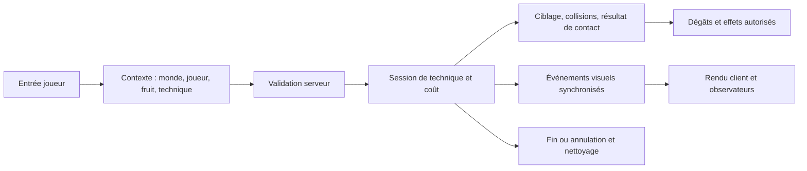

# Fruits du démon : audit du socle et estimation

État au 15 octobre 2026. Le besoin a été recentré sur la revue du socle avant la réparation de l'ensemble des techniques. **Cet audit ne constitue pas une version corrigée : aucun JAR ni aucune partie n'a été modifié.**

## Mise à jour après lecture du document d'état du portage

Le PDF fourni ensuite par l'utilisateur (15 pages) décrit une implémentation et une recette serveur déjà importantes. Ses recommandations sont du contexte documentaire, pas des instructions nouvelles de l'utilisateur. Il faut préserver et réutiliser ce travail, puis confronter les affirmations à la version installée.

| Sujet | Document | Vérification locale / conséquence |
|---|---|---|
| Catalogue | 40 fruits, 213 techniques | Confirmé par le harnais local |
| Animations | 151 paires extraites, 145 annoncées comme traduites/livrées, quatre correspondances par nom | Le JAR retourne nombreDePaires=151, pairesConnues=155 et couvertureExacte=145. Le dernier compteur inclut aussi les correspondances par nom dans son calcul : ne pas additionner automatiquement quatre à 145 sans vérifier la répartition |
| Tests | 312 PASS, 310 contrôles distincts sur serveur réel | Déclaration du document ; scripts/rapport détaillé et correspondance au hash installé non disponibles localement, donc recette non reproduite pendant cet audit |
| Rendu | 0 fruit sur 40 validé visuellement ; signalement « personnage bouge mais on ne voit rien » encore ouvert | Confirme que la recette serveur ne constitue pas une validation des effets vus par le joueur |
| Joueurs de test | FakePlayer invulnérable et non réellement ajouté au monde | Limite reconnue par le PDF ; compléter avec cibles réellement dommageables et joueur réel pour mort/équipes/rendu |
| Réseau d'animation | Paquet annoncé au lanceur et aux observateurs | Dans le JAR inspecté, sendAnimation envoie uniquement au joueur reçu en argument. Écart à expliquer avant d'adopter le document comme preuve de diffusion |
| Transformations | Modèle vanilla encore visible sous la transformation ; quadrupède complet à créer | Distinguer la correction d'un rendu existant de la création d'une forme supplémentaire |
| Persistance | Rechargement après redémarrage testé | Compatible avec notre constat de fichier global : persistance et isolation entre deux mondes sont deux propriétés différentes |

Le PDF indique les chemins relatifs `docs/CORE-030-rapport-tests.md`, `docs/CORE-030-recette-de-tests.md`, `docs/fruits/`, `docs/ANIMATIONS-JOUEUR.md` et `tools/run_tests.py`. Il ne fournit ni adresse de dépôt ni emplacement du projet. Ces fichiers deviennent les références à récupérer si le projet est retrouvé ; leur contenu n'est pas déduit de leur titre.

**Ajustement de méthode :** commencer le diagnostic client par Neko Neko Leopard, Goro Goro et Pika Pika, que le document annonce comme les mieux couverts en gestes. Garder Gomu/Mera/Hie pour les scénarios de mécanique différents du lot pilote ci-dessous. Vérifier le diagnostic de technique et le lancement direct par commande sur une copie, puis suivre une activation jusqu'au rendu réellement observé. Réutiliser la recette serveur dès qu'elle est disponible et ajouter des contre-épreuves aux défauts mesurés.

**Lecture de l'estimation :** la fourchette 30–55 jours ci-dessous reste une enveloppe provisoire pour la reprise et la validation complète des 40 fruits, et ne justifie aucune réécriture générale. Le coût du premier correctif ciblé n'est pas établi par le PDF. Il doit être recalibré après confrontation du projet/rapport de tests au JAR installé et un premier scénario visuel réel. Le PDF apporte des contrats et des preuves déclarées utiles, mais pas les fichiers permettant de les exécuter.

## Base vérifiée

Référence de travail : OP World Like Fabric 1.0.0 actuellement installé, SHA-256 `533f67283d551b37af2a074dc180326a191c31a8e9e5aaba0c1de31bd167c256`. L'ancien CSV de chantier téléchargé référence un autre hash ; ses constats et validations ne peuvent donc pas être repris automatiquement.

Les paquets client téléchargés examinés contiennent les JAR et un guide, sans sources Java/Gradle. Le projet source correspondant n'a pas été localisé et l'utilisateur ne connaît pas son emplacement. Cela augmente le travail de reprise et la sensibilité des correctifs au bytecode exact. Les JAR déclarent des droits réservés : recherche et éventuels correctifs restent privés ; aucune publication n'est engagée.

Un harnais isolé charge le vrai Fabric/Minecraft et lit le catalogue par réflexion après le bootstrap des registres. Il n'exécute pas les points d'entrée des mods et ne charge aucun monde. Les nombres ci-dessous décrivent le catalogue avant l'application des réglages d'équilibrage de démarrage ; ils ne constituent pas des essais de combat.

| Mesure | Résultat |
|---|---:|
| Fruits | 40 |
| Entrées de techniques | 213 |
| Type MELEE | 120 |
| Type PROJECTILE | 65 |
| Type BUFF | 27 |
| Type EFFECT | 1 |
| Noms de techniques différents, sans identifiant du fruit | 178 |
| Noms partagés entre plusieurs fruits | 13 |
| Entrées concernées par ces noms partagés | 48 |
| Associations de visuels explicites | 82 : 62 projectile, 20 mêlée |
| Géométries différentes utilisées par ces associations | 25 |

Le diagnostic du mod parle de « 35 techniques partagées » : il compte les 35 occurrences excédant les 178 noms uniques. Cela correspond à 13 groupes de noms et 48 entrées concernées. Les couples fruit + technique sont uniques.

Les modèles et textures des 82 associations existent. Les 25 géométries associées disposent d'un fichier d'animation ; deux modèles de fantôme proposent `idle1`/`idle2` plutôt que `idle`, ce qui doit être vérifié contre l'état réellement demandé. L'existence des fichiers ne prouve ni le bon choix du visuel ni la fidélité de son mouvement.

## Ce que le socle fait déjà

Le dispatcher effectue des contrôles de joueur vivant/spectateur, de fruit, de suppression des pouvoirs, de recharge et d'énergie. Il délègue à des comportements spécifiques, puis à des actions génériques. Les projectiles portent déjà des données synchronisées de modèle, texture, animation et échelle. Il existe un stockage des joueurs, des mécanismes de techniques prolongées et des services spécialisés pour plusieurs fruits.

Il faut conserver ces fonctions utiles et les vérifier progressivement. Le contrôle de versions effectué précédemment valide le chargement des six mods ; il ne valide pas les 213 techniques. Les nombres de tests annoncés dans d'anciens guides ne sont pas des preuves de comportement dans cette installation.

## Défauts communs et risques

| Priorité | Constat | Preuve / limite | Reprise nécessaire |
|---|---|---|---|
| P0 | Identité incomplète des techniques | `moveById`, les tables de visuels et plusieurs appels utilisent un nom seul ; 13 noms sont partagés | Référencer chaque technique par fruit + technique, avec migration de la sélection sauvegardée et validation des tables |
| P0 | Dégâts et effets ne suivent pas toujours le même résultat | Dans la mêlée générique et l'impact de projectile, le retour de `hurtServer` est ignoré avant l'application d'effets/recul ; un autre chemin `strikeTargets` le respecte | Introduire un résultat de contact commun. Distinguer refus, absorption, blocage et immunité ; décider explicitement quels effets sont autorisés dans chaque cas |
| P0 | Garde des dégâts à vérifier | 20 suppressions observées sur feu/lave ; pile alimentée dans ALLOW_DAMAGE et nettoyée via AFTER_DAMAGE | Tester les sorties précoces, annulations et exceptions avec nettoyage garanti. Les messages seuls ne prouvent pas que tous les blocages sont erronés |
| P0 | Données de joueurs communes aux mondes | Chemin statique relatif `config/opworldlike/devilfruit-players.dat`, map statique ; fichier présent dans l'instance. `loadAll` n'efface pas cette map et `saveAll` écrit directement | Stockage versionné par monde, séparation état durable/effets temporaires, sauvegarde atomique et migration sur copie. Ne pas attribuer automatiquement le même historique à tous les mondes |
| P1 | Diffusion des animations incomplète | `sendAnimation` et `sendTransformState` envoient au joueur concerné ; le récepteur d'animation sait cibler un entityId | Diffuser aux observateurs concernés, initialiser un observateur qui arrive, traiter changement de dimension et déconnexion. L'envoi au propriétaire existe déjà : ce point ne suffit pas à expliquer seul ses défauts de rendu |
| P1 | Résultats d'exécution trop pauvres | L'exécution repose sur des booléens ; un comportement spécifique retournant false laisse place au chemin générique. Énergie débitée avant exécution et remboursée sur false | Distinguer non pris en charge, refusé, démarré, terminé et annulé. Garantir le règlement du coût même en cas d'exception, sans inventer de nouvelle règle d'équilibrage |
| P1 | Rendu et logique à rapprocher | Catalogue réparti entre dispatcher, comportements spécifiques, tables de visuels, animations et services prolongés | Un contrat commun décrit portée, durée, trajectoire, collisions, phases, effets et événements visuels ; des exécuteurs spécialisés restent possibles |
| P1 | Ressources invalides | Animation Marco contenant `nan`, UV Murakumogiri hors texture, son guard absent : erreurs du journal réel | Corriger les ressources en contrôlant aussi les noms d'animation, dimensions, visibilité et ressources réellement demandées |
| P1 | Interaction VOID DYNASTY | Les dégâts directs d'armes utilisent `playerAttack`, donc les résistances physiques MinePiece | Règle explicite pour armes physiques/énergétiques et tests avec/sans Haki, Logia/Gomu/Yami ; conserver les résistances voulues |

Les sorties précoces du garde de combat, le nettoyage des effets prolongés et les différences entre première/troisième personne nécessitent encore des scénarios exécutés. Une inspection de bytecode ne suffit pas à déclarer les 213 techniques réparées.

## Architecture cible

Un événement visuel transporte l'identité de la session, l'entité, la dimension, le début serveur et les paramètres nécessaires. Le client ne calcule pas les dégâts. Une même définition pilote la portée physique et sa représentation ; un rayon, un projectile, une zone et une transformation conservent leurs exécuteurs propres. Chaque session prévoit sa fin et le nettoyage après mort, changement de dimension, déconnexion ou arrêt du monde.

Le stockage durable conserve fruit/progression/choix de technique. Une session active, un recul ou une animation ne doivent pas être restaurés comme une progression permanente après redémarrage. Les blocs temporaires nécessitent leur propre suivi et leur restauration vérifiée.

## Lots et critères de sortie

| Lot | Travail | Preuve attendue | Charge indicative |
|---|---|---|---:|
| 0 — Reprise reproductible | Figer le JAR, constituer une référence privée, retrouver les sources si possible, préparer un projet de correction et un profil de test isolé | Construction reproductible ; baseline avec les six mods ; aucune perte de sauvegarde | 2–4 jours |
| 1 — Socle | Identités, résultats d'exécution/contact, coûts, garde de combat, cycle de vie, événements réseau, stockage/migration et diagnostic | Refus sans effet indu ; coût cohérent ; annulations propres ; deux mondes isolés ; résultat identique après recharge | 6–10 jours |
| 2 — Trois fruits pilotes | Gomu pour mêlée/bras, Mera pour projectile/feu, Hie pour zone/gel/terrain | Actions reproductibles avec cible témoin, mur, cible immunisée, annulation et recharge ; rendu réellement observé | 3–5 jours |
| 3 — Généralisation | Adapter les 37 fruits restants ; vérifier les transformations Zoan, invocations, champs et techniques prolongées | Fiche de résultat pour chacune des 213 entrées, avec effet et rendu contrôlés | 15–30 jours |
| 4 — Stabilisation | Charge/performance, persistance, autres mods, réglages d'effets, installation et retour arrière | Sessions prolongées, recharge, plusieurs dimensions, absence de régression du pont et des inventaires | 4–6 jours |

**Total de travail indicatif : 30 à 55 journées de développement et de test pour une alpha cohérente couvrant les 40 fruits**, en arrondissant les lots (30–55 jours). À une personne à temps plein, cela représente environ 6 à 11 semaines de travail. **Le socle représente 6 à 10 jours après la reprise du projet**, et le premier ensemble socle + trois fruits pilotes environ 11 à 19 jours en incluant la reprise.

Ce sont des charges provisoires, pas un engagement de délai ni une estimation du temps d'une conversation. Elles intègrent une reprise privée à partir des JAR ; l'absence du projet source, les écarts visuels attendus et les essais réellement exécutés peuvent modifier la fourchette. Rechiffrer après les trois fruits pilotes. Une reproduction fidèle de tous les effets d'origine, avec de nouveaux modèles/animations si nécessaire, constitue un objectif supplémentaire à estimer après comparaison technique par technique.

## Validation et ressources

Pour le premier lot, aucun nouvel asset n'est nécessaire : les ressources déjà installées suffisent pour vérifier le moteur. Ensuite, demander une référence précise uniquement lorsqu'un rendu est absent ou que son résultat attendu est indéterminé.

La validation doit couvrir cible ordinaire et cible à résistance, première/troisième personne, observateurs, obstacle, portée, fin de durée, spam d'entrée, énergie insuffisante, recharge, mort, déconnexion, changement de dimension et rechargement du monde. Ajouter des essais de sauvegarde interrompue et de restauration des blocs temporaires. Les tests automatisés de logique sont complétés par des captures/observations du rendu et des mesures de vie dans le jeu.

Ordre retenu pour la suite : **identités et diagnostic, cohérence dégâts/effets et garde, isolation/persistance, cycle de vie et réseau, puis fruits pilotes**. Préserver l'ancien stockage et les mondes avant toute migration ; ne pas publier ou installer une refonte non validée.

Preuves privées : `.runtime/fruit-foundation/catalogue.json`, `summary.json`, `catalogue.log`, `asset-reference-results.json` et `techniques-auditer.csv` (213 lignes, tous les essais de rendu/effet marqués A_TESTER). Les inspections dérivées sont conservées hors du dépôt dans le dossier temporaire de recherche. Aucun correctif du socle n'a été construit ou installé pendant cette phase d'audit.
