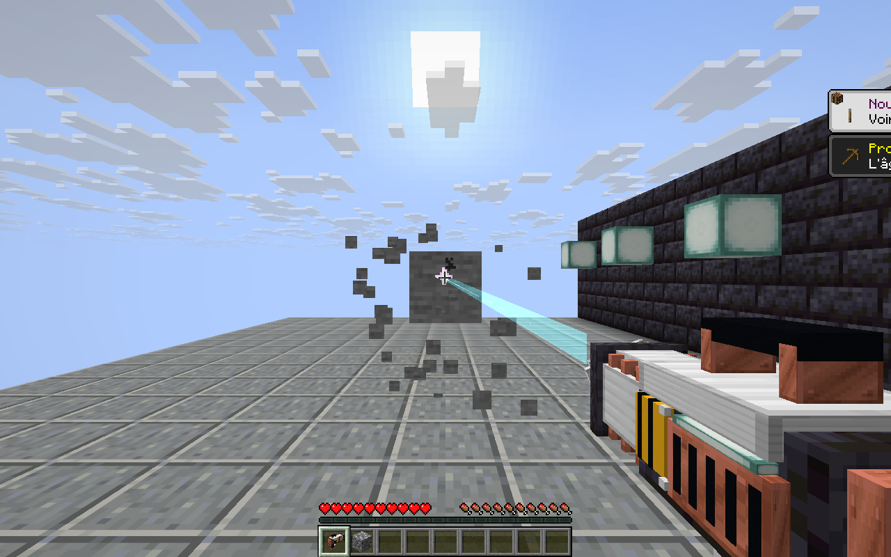
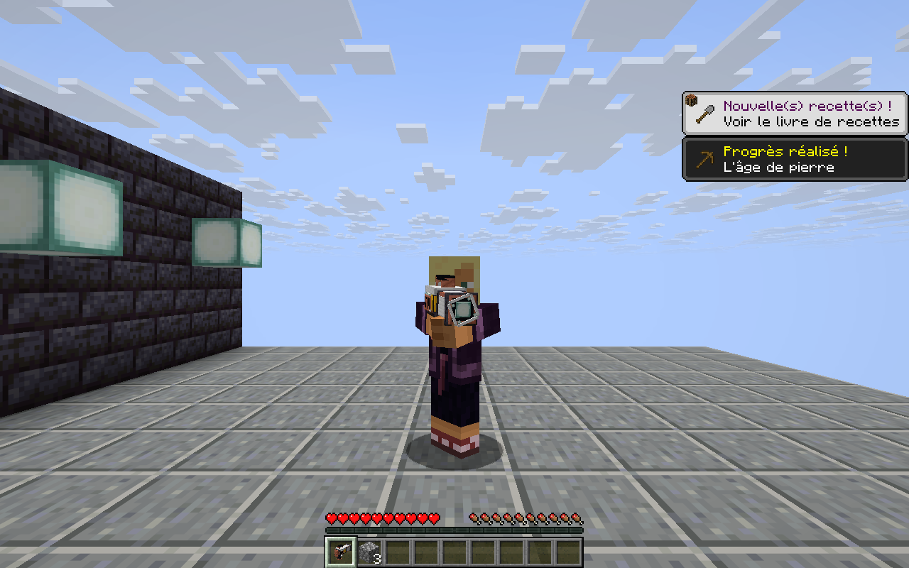

# Foreuse laser — alpha.95

La foreuse utilise désormais un modèle Minecraft en volume, avec blindage sombre, capot d'acier, colliers en cuivre, poignée, batterie, évents et panneaux de danger. La tête de focalisation tourne pendant le forage ; la lentille et les éléments d'énergie s'allument, et le corps vibre légèrement. Une pose à deux mains accompagne son utilisation en troisième personne.

## Utilisation

Maintenir le clic droit pour charger la foreuse pendant 0,3 seconde, puis forer. Relâcher le bouton arrête immédiatement le forage et le faisceau. La portée reste de 8 blocs. La collecte est progressive : un bloc visible toutes les 0,4 seconde, avec transfert direct des ressources dans l'inventaire et dépôt au sol de l'excédent.

L'ancien clic instantané parcourait plusieurs positions dans une ligne. Le nouveau fonctionnement cible le premier bloc solide ; un obstacle indestructible, un conteneur ou un claim bloque le forage et protège les blocs derrière. Le serveur contrôle les mutations et n'accorde les ressources qu'après une casse réussie.

## Présentation

- Modèle de 61 cuboïdes, décliné en repos, charge et quatre images de rotation.
- Faisceau turquoise à cœur blanc, dessiné en géométrie lumineuse continue. Il disparaît au relâchement ; il ne laisse pas de nuage de particules dans l'axe de visée.
- Étincelles au contact, petite fumée et montée en charge lumineuse.
- Son de démarrage, bourdonnement pendant le maintien et extinction au relâchement. Les sources sonores suivent le joueur et sont libérées à l'arrêt ou à la déconnexion.
- Matériaux et sons Minecraft existants ; aucune nouvelle bibliothèque ni texture de jeu copiée dans le mod.

Le faisceau est lumineux par lui-même ; il ne crée pas de source de lumière dynamique dans le monde.

## Installation

Minecraft Java 26.3, Fabric Loader 0.19.5, Java 25, Fabric API et GeckoLib comme pour alpha.94. Fermer le jeu et remplacer l'ancien JAR principal `voiddynasty` par `voiddynasty-1.3.0-alpha.95.jar` dans `mods`, en ne gardant qu'une version du mod principal. Mettre le même JAR sur le client et le serveur pour bénéficier du comportement et des effets.

Cette version comprend les corrections du servitor d'alpha.94. Le changement du drill est présenté séparément dans Git sur une branche issue de cette version.

## Développement et vérification

`python tools/generate_laser_drill.py` régénère les modèles et la définition d'item. Les propriétés natives `using_item`, `use_duration` et `use_cycle` choisissent les poses sans nouveau paquet de modèle. L'extraction graphique transmet uniquement les positions du faisceau à la soumission de géométrie ; aucune entité serveur n'est créée pour ce rendu.

`gradlew build` compile le mod et les fixtures, et exécute les 46 assertions de conservation existantes. `tools/run_drill_lab.py` lance un client et un serveur locaux jetables, avec profil neuf et chemins explicites vers les dépendances installées. L'EULA Minecraft doit être accepté avec `--accept-eula`.

Le laboratoire utilise réellement le maintien et le relâchement côté client. Il vérifie la collecte exacte de trois blocs, l'arrêt côté serveur, le blocage par la bedrock, la conservation d'un coffre et de ses sept diamants, ainsi que le refus du terrain protégé. Cinq captures servent au contrôle visuel du repos, de la charge, du faisceau, de la pose à la troisième personne et de l'arrêt.

## Captures en jeu

Les captures proviennent du client de test réel, sans shader additionnel. Le JAR livré a passé les sept phases client/serveur du laboratoire, la compilation Gradle avec 46 assertions de conservation et les 24 tests Python existants.
