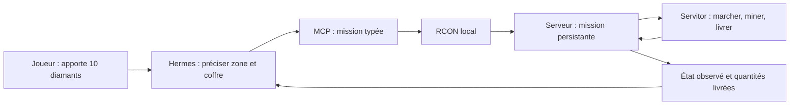

# Servitor polyvalent — première étape

Branche : `codex/servitor-polyvalent`. Version : **1.3.0-alpha.1**. Date : 17 octobre 2026.

Le premier jalon exécute une mission de collecte bornée : le servitor physique cherche les blocs correspondants dans une zone explicite, les mine avec le butin natif, puis livre la quantité demandée dans un coffre simple ou un tonneau désigné. Il conserve son sac, ses reçus de minage et sa mission après un redémarrage propre. Le dépôt de chantier est toujours construit par le servitor ; sélectionner une zone ne demande pas de dépôt préalable. Le coffre de livraison final doit déjà exister.

Hermes interprétera la demande en langage naturel et choisira les paramètres. Le mod exécute et vérifie les opérations sur le thread serveur. Aucun appel à un modèle n'est nécessaire dans la boucle de déplacement/minage. Le transport MCP stdio est testé avec un vrai client SDK ; la connexion à l'instance personnelle d'Hermes reste à configurer.



## Ce qui fonctionne

- Catalogue de 19 ressources : neuf essences de bûches, pierre taillée en cobblestone, deepslate en cobbled deepslate, diamant, charbon, émeraude, redstone, lapis, fer brut, cuivre brut et or brut. Les variantes de minerai deepslate sont reconnues.
- Objectif de 1 à 4096 objets dans une zone de 32768 blocs maximum. Les blocs d'autres types sont ignorés. Les objets déjà présents dans le coffre ne comptent pas comme une livraison.
- Livraison plafonnée à la quantité demandée. Le surplus d'un drop multiple est conservé dans les dépôts du chantier avant la réussite.
- Pause si le coffre est plein, absent, protégé ou inaccessible. Une zone épuisée donne `INCOMPLETE`, jamais une réussite inventée.
- Une seule mission attachée par dimension. Une seconde demande ne remplace pas le travail en cours.
- Clé `request_id` persistante : un nouvel essai identique renvoie le même UUID, même après fermeture de mission et redémarrage. La même clé avec d'autres paramètres est refusée. Historique limité à 128 missions par dimension, sans éviction automatique.
- Annulation conservant les objets, récupération du sac vers le dépôt, et rollback utilisant les reçus exacts. Les autres objets du coffre restent préservés.

## Outils MCP

| Outil | Usage |
|---|---|
| `servitor_capabilities(dimension)` | Lire le catalogue et les limites réellement disponibles sur le serveur. |
| `servitor_gather(request_id, item, amount, zone_min, zone_max, destination, origin, dimension)` | Soumettre la mission. `origin` est le départ du servitor, les positions sont des listes de trois entiers. |
| `servitor_mission_status(mission_id, dimension)` | Suivre un UUID ou `current`. |
| `servitor_mission_control(mission_id, action, dimension)` | `pause`, `resume`, `cancel`, `deposit`, `rollback`, `close`. |

`dimension` vaut `overworld` par défaut. Le coffre final et son support doivent être hors de la zone de minage. La destination accepte un coffre simple ou un tonneau chargé ; les doubles coffres et conteneurs de machines sont refusés dans ce jalon.

Exemple d'arguments pour `servitor_gather`, après vérification du terrain et du coffre :

```json
{
  "request_id": "diamants-maison-001",
  "item": "minecraft:diamond",
  "amount": 10,
  "zone_min": [100, -52, 100],
  "zone_max": [110, -50, 110],
  "destination": [115, -50, 100],
  "origin": [112, -50, 100],
  "dimension": "overworld"
}
```

Ces coordonnées illustrent le format : elles ne décrivent pas une zone de minerai connue. Cette version ne creuse pas un tunnel à travers les blocs ignorés pour atteindre le minerai.

Le résultat contient `ok`, `mission`, `dimension`, `attached` et `worker_active`. La mission expose son UUID, son état, sa raison, `collected_total`, `delivered_total` et `goal_met`. Tant qu'elle est attachée, le résultat inclut aussi `carried_items`, `journal_entries`, `rollback_state`, `rollback_remaining` et `detail`.

Une soumission acceptée ne prouve pas que la tâche est terminée. Hermes doit conserver l'UUID et interroger son état. Après un timeout, réutiliser la même clé et les mêmes paramètres ; ne pas créer une seconde demande avec une nouvelle clé. Les erreurs (`WORKER_BUSY`, `REQUEST_CONFLICT`, `INVALID_DESTINATION`, etc.) sont structurées avec `ok: false`, `error` et `detail`.

## Cycle de vie et conservation

`PREPARING → MINING → DELIVERING → STORING_REMAINDER → SUCCEEDED` décrit la progression ; certaines étapes peuvent être sautées. `PAUSED` conserve le travail pour `resume`. `INCOMPLETE` et `CANCELLED` sont terminaux. Une mission non terminée reprend en pause après redémarrage ; une reprise explicite est nécessaire.

`cancel` arrête la mission sans supprimer le sac ou les reçus. Si le sac contient des objets, `deposit` les fait rapporter physiquement dans le dépôt de chantier ; attendre `worker_active: false` et `carried_items: 0` avant de fermer. Cette récupération reste possible après annulation ou résultat incomplet.

`rollback` arrête la mission, récupère les drops exacts dans le sac et les dépôts connus, puis restaure les blocs journalisés. Il refuse les ressources manquantes et les terrains modifiés. Suivre **`rollback_state` jusqu'à `COMPLETE`**, ou traiter `FAILED`/`PARTIAL` ; le statut `CANCELLED` seul n'atteste pas la fin de la restauration. La mission devient annulée avec `goal_met: false`. Les compteurs `*_total` restent l'historique des opérations effectuées, pas le solde après rollback. Les coffres et supports du kit de chantier restent en place.

`close` exige une mission terminale, un chantier arrêté, un sac vide et aucun rollback en cours. Il libère le servitor et **abandonne explicitement les reçus de rollback**. L'identité de la demande reste archivée. Retarder `close` tant qu'un rollback doit rester possible.

La sauvegarde passe au format 4 ; les formats 2 et 3 restent lisibles. Tester les mises à jour sur une copie de monde. La conservation après arrêt propre est validée ; l'atomicité entre terrain, coffre et SavedData lors d'une coupure brutale pendant l'écriture disque reste un chantier ouvert.

## Préparer le raccordement à Hermes

Utiliser le [pack alpha](../../client-local/voiddynasty-1.3.0-alpha.1) sur un serveur Fabric de test. Installer les dépendances Python dans un environnement séparé :

```text
python -m venv .venv
<python de .venv> -m pip install -r voiddynasty/tools/requirements-mcp.txt
```

Configurer le serveur Minecraft avec `enable-rcon=true`, un `rcon.port` disponible et un mot de passe privé. Restreindre l'accès RCON à la machine du serveur. Ne pas publier `server.properties`. Le processus MCP lit ce fichier dans le dossier indiqué par **`VD_SERVER_DIR`** et se connecte à `127.0.0.1`.

Dans le client MCP/Hermes, choisir le Python de cet environnement comme exécutable, le chemin absolu de `voiddynasty/tools/mcp_vd.py` comme argument, et transmettre `VD_SERVER_DIR` comme variable d'environnement. Le format exact de configuration dépend du client. Le MCP doit tourner sur l'hôte Minecraft ; un Hermes distant devra utiliser un transport géré vers cet hôte.

Le serveur MCP conserve aussi six outils historiques d'administration. Pour le rôle servitor, limiter la liste d'outils autorisés aux **quatre `servitor_*`** ci-dessus. Le protocole typé valide les identifiants, UUID, coordonnées et quantités avant RCON ; il ne reçoit pas de texte de commande libre.

Instruction proposée pour le rôle Hermes : consulter les capacités ; obtenir une zone autorisée et un coffre précis ; soumettre une demande identifiée ; suivre l'état observé ; expliquer les pauses ; ne jamais annoncer la réussite sur la seule acceptation ; ne fermer ou annuler les reçus que sur instruction explicite. Les limites du serveur restent applicables indépendamment des instructions du modèle.

## Validation et prochaines étapes

Le JAR alpha livré passe 38 assertions natives d'inventaire, transfert et persistance, 48 assertions de régression dans le monde de test, 32 assertions natives de missions et 22 contrôles via un véritable client MCP stdio. Les 11 cas de test Python couvrent aussi validation d'entrée, protocole RCON et erreurs réseau. Deux arrêts et relancements complets du serveur font partie de la recette. Les tests de mission vérifient coffre plein, contenu existant, requêtes répétées, concurrence, rollback, annulation avec sac, épuisement de zone et surplus de cuivre.

Les lanceurs sont `tools/run_work_tests.py`, `tools/run_work_lab.py --missions` et `python -m unittest discover -s voiddynasty/tools/tests`. Le laboratoire utilise un monde neuf, une écoute locale et un mod de fixtures séparé du JAR jouable. Les dépendances MCP sont nécessaires pour `--missions`. Voir [VALIDATION.md](../../client-local/voiddynasty-1.3.0-alpha.1/VALIDATION.md).

Ordre proposé pour les prochains lots :

1. Navigation de travail : accès aux minerais, escaliers, obstacles, dangers et reprise de chemin. Aujourd'hui seuls les blocs correspondants physiquement accessibles sont récoltés.
2. Construction depuis un plan borné : estimation et réservation des matériaux, pose physique, contrôle du résultat, rollback tenant compte des ressources consommées. La maison libre en langage naturel n'est pas implémentée.
3. Fabrication et économie : remplacer le kit d'opérateur (pioche, 64 coffres et 64 supports) par une chaîne de ressources réelle.
4. Extension aux métiers, files de tâches et plusieurs servitors, puis connexion/recette avec Hermes et interface en jeu.

Il manque encore une validation visuelle client de ces missions, les cas de toutes les dimensions et la résistance aux arrêts brutaux. Cette alpha est un premier jalon fonctionnel du servitor polyvalent, pas une version complète du plan.
